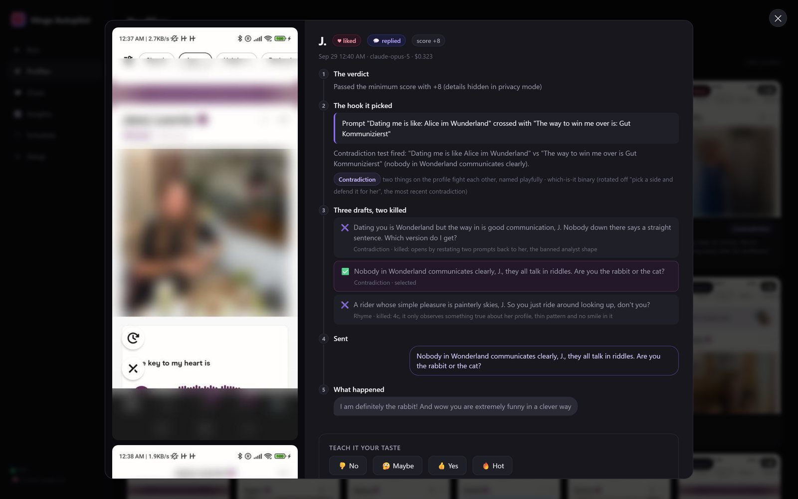
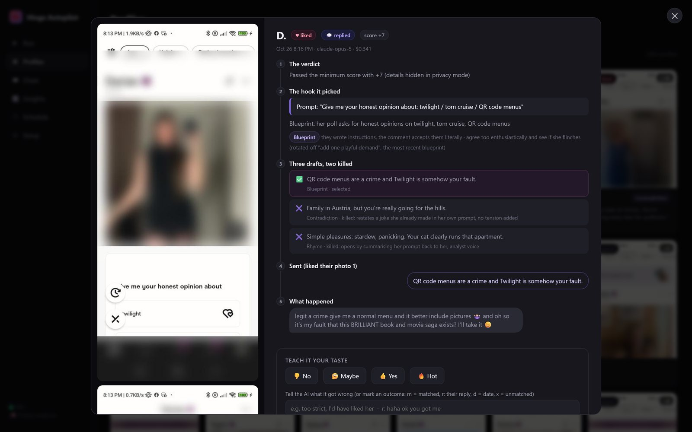
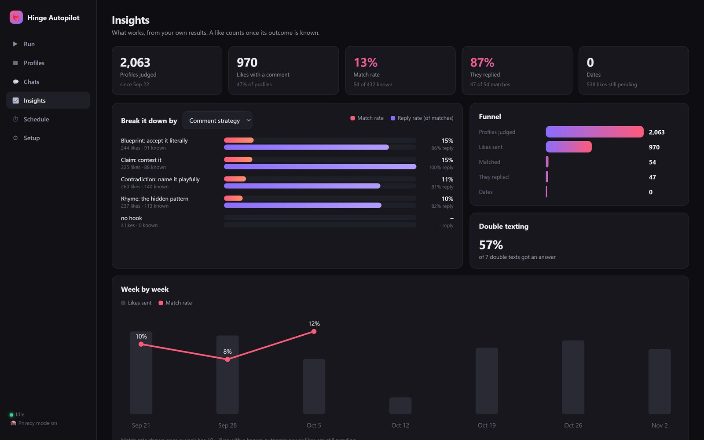
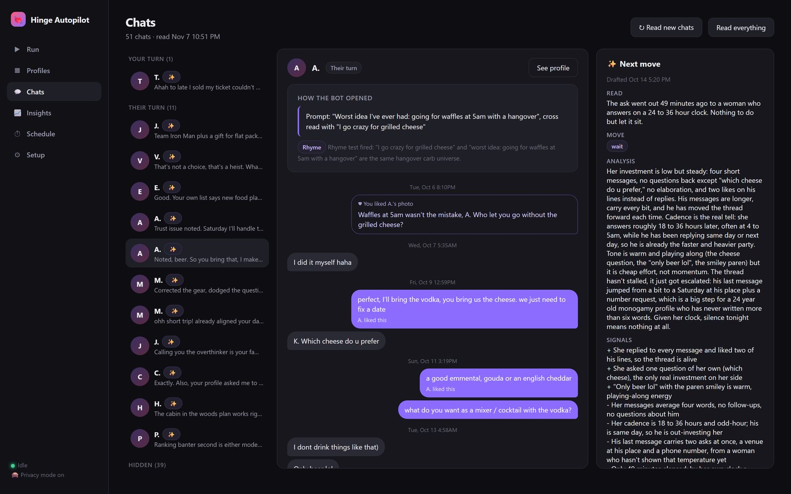
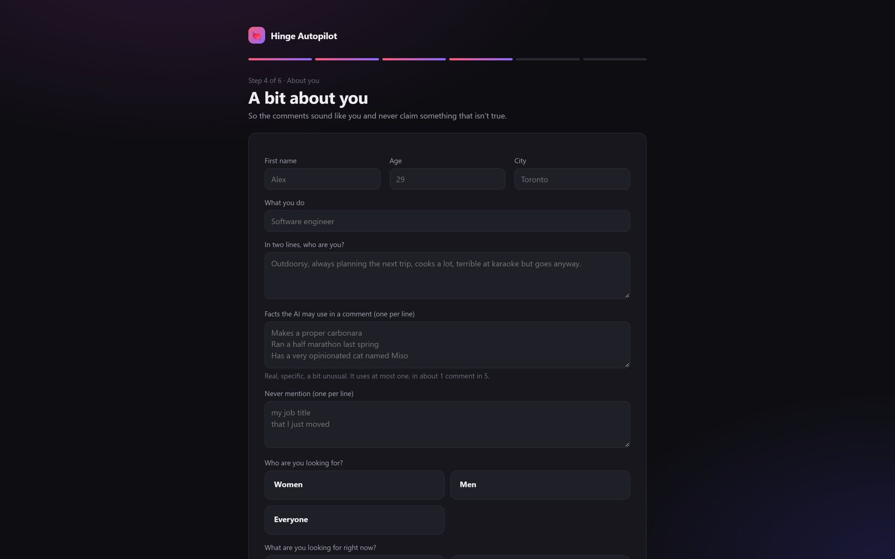

# Hinge Autopilot

An AI wingman for Hinge. It drives Hinge on your Android phone, reads every profile, decides like or skip
against *your* type, and sends each like with a comment written for that one person. Then it reads your
chats, drafts your next message, and shows you which strategies actually get matches and replies.

Everything runs on your computer. You bring the AI key (Claude, OpenAI or Gemini).



<sub>Real results from the author's own account. Screenshots are taken in the app's privacy mode: photos,
names and the AI's notes are blurred or hidden.</sub>

## How a comment gets written

For every profile it:

1. **Screens it** against what you told it: age range, your type, green flags, dealbreakers, and what
   you're looking for right now. It scores the profile; below your minimum score it skips.
2. **Finds a hook** by running four tests in order:
   - **Contradiction:** two things on the profile fight each other.
   - **Rhyme:** a pattern across prompts that the writer didn't notice.
   - **Claim:** a bragged skill worth contesting.
   - **Blueprint:** written instructions to take literally.
3. **Drafts three comments**, then kills the ones that sound like a bot: restating their prompt, explaining
   the joke, a deletable warm-up clause, anything that could be sent to anyone else.
4. **Sends the survivor** on the prompt it's about, in your voice, with no dashes and no "haha hey".

Every decision is logged with the drafts and the reason each one died, so you can see exactly how a
comment came to be.



## What's in the app

| Page | What it does |
|---|---|
| **Setup** | Downloads Android's `adb`, detects your phone, tests your AI key, then asks about you, your type and how you text |
| **Run** | Start/stop, live view of the phone screen, latest decisions, run log |
| **Profiles** | Every judged profile. Filter, sort, open one to see prompt → hook → drafts → sent → their reply. Rate profiles 👎 🤔 👍 🔥 to teach it your taste |
| **Chats** | Reads your matches off the phone, shows how the bot opened, drafts the next message or tells you whether to double text |
| **Insights** | Match and reply rate by strategy, score, looks, age, comment length, time and day; funnel; week by week; double-text stats |
| **Schedule** | Swipes every day at a slightly different time, reads chats after each run, dry run, privacy mode |

**Privacy mode** blurs photos and names everywhere in the app, so you can take screenshots.

### Insights: which strategy gets matches



### Chats: the next move, drafted



### Setup: a few questions about you



## Get started

You need an Android phone (or emulator) with Hinge, a USB cable, Python 3.10+, and an API key.
iPhone isn't supported.

```sh
git clone https://github.com/EphremBeaino/hinge-autopilot
cd hinge-autopilot
start.bat        # Windows
./start.sh       # macOS / Linux
```

The first launch installs the dependencies and opens http://127.0.0.1:8765, where the setup steps walk
you through the rest. Try a **dry run** first: it judges and logs profiles but never likes anyone.

The comment's quality depends on the model: Claude does it best. A profile costs roughly $0.01 to $0.30
depending on the model.

## Your data

Profiles, screenshots, chats and keys stay in `data/` on your computer and are git-ignored. The only
outside calls go to the AI provider you pick, and to Google once to download `adb`.

## Fair warning

Automating Hinge is against its terms of service and can get your account banned. The bot never
sends chat messages for you; it only drafts them. Use it at your own risk.

## License

MIT. Built on top of an earlier open-source Hinge automation project; see [LICENSE](LICENSE).
